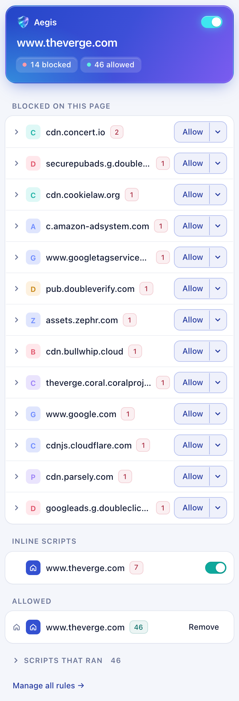
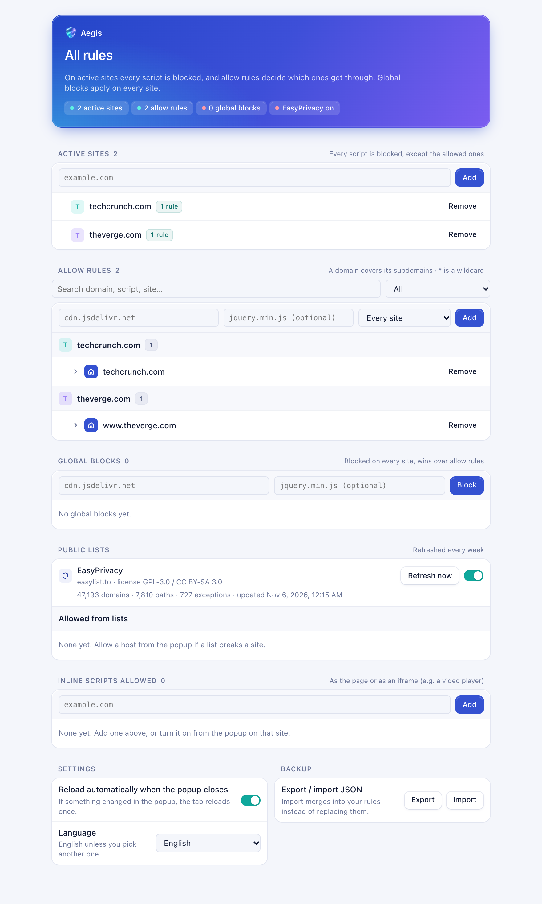

<div align="center">
  
  <h1>Aegis</h1>
  <p>Blocks scripts on the sites you choose and lets through only the ones you allow.</p>
  <p>
    <a href="https://github.com/greezyzilla/aegis/releases/latest"></a>
    <a href="https://github.com/greezyzilla/aegis/actions/workflows/check.yml"></a>
    <a href="LICENSE"></a>
  </p>
  <p>
    <a href="#install">Install</a> · <a href="docs/how-it-works.md">How it works</a> · <a href="CONTRIBUTING.md">Contributing</a>
  </p>
  <picture>
    <source media="(prefers-color-scheme: dark)" srcset="docs/images/popup-dark.png">
    
  </picture>
</div>

Some sites load ads from a different vendor every week, so blocking them by domain never keeps up. On those sites Aegis blocks every script, and you allow the few the page actually needs from the popup. Everywhere else it stays out of the way, apart from trackers you block globally or pull in from EasyPrivacy.

Runs in Brave/Chrome and Firefox 140+. It is not on the extension stores.

## Install

Download the files from the [latest release](https://github.com/greezyzilla/aegis/releases/latest).

**Brave / Chrome.** Unzip `aegis-X.Y.Z-chrome.zip`, open `brave://extensions` (or `chrome://extensions`), turn on Developer mode, click **Load unpacked** and pick the unzipped folder. In Brave, leave Shields' own script blocking off so the two don't overlap.

**Firefox.** Download `aegis-X.Y.Z-firefox.xpi`, then in `about:addons` open the gear menu and choose **Install Add-on From File**. It is signed by Mozilla as an unlisted add-on, so it stays installed after a restart.

The Firefox build updates itself: Firefox checks the latest release and installs a newer signed `.xpi` on its own. Copies installed from v0.2.0 or earlier do not know where to look, so install the next release by hand once. The Brave/Chrome build does not update itself: to upgrade, load the newer release the same way.

## Using it

Nothing is blocked until you activate a site, add a global block or turn on a list.

Open the popup on a site and turn on the switch at the top. The header turns blue, and from then on every script on that site is blocked, inline ones included. After a reload the popup lists what was blocked, grouped by domain, with the site's own domains first. **Allow** lets a domain or a single script through on this site; the arrow next to it holds **Allow on every site** for every active site. Inline scripts are listed per frame, so an embedded player can be allowed without allowing the page around it. With auto-reload on, the default, the tab reloads once when you close the popup.

On a site that is not active, the popup lists the scripts that ran. **Block** blocks one on every site, active or not, and a global block wins over allow rules.

The options page holds everything else: allow rules, global blocks, active and inline-allowed sites, EasyPrivacy (downloaded from easylist.to when you turn it on, refreshed weekly) and a JSON export/import of your settings. If EasyPrivacy breaks a site, allow the host from the popup.

<picture>
  <source media="(prefers-color-scheme: dark)" srcset="docs/images/options-dark.png">
  
</picture>

The interface is in English. Under Settings in the options page you can switch it to Bahasa Indonesia, or let it follow the browser's language.

## Limitations

- It blocks scripts and nothing else: images, iframes and other requests load as usual.
- Firefox allows 5,000 dynamic blocking rules, Chrome 30,000. EasyPrivacy needs about 8,500, so on Firefox the least script-like path entries are left out. The options page shows how many.

## Development

```bash
npm install
npm run dev            # Chromium with the extension loaded and hot reload
npm run build          # dist/chrome-mv3 (npm run build:firefox: dist/firefox-mv3)
npm test
```

[CONTRIBUTING.md](CONTRIBUTING.md) covers the browser test suites, branches, commit messages and releases. [docs/how-it-works.md](docs/how-it-works.md) explains how the blocking is built on `declarativeNetRequest`.

## License

[PolyForm Noncommercial 1.0.0](LICENSE): free to use, change and share for non-commercial purposes. Selling it is not allowed.
